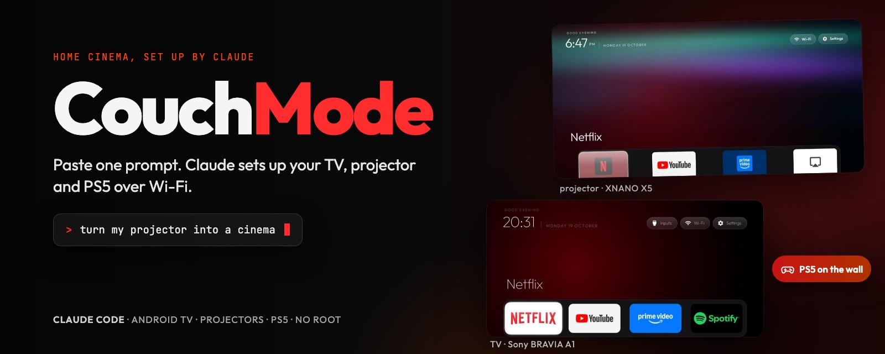

<p align="center">
  
</p>

<h1 align="center">Projector 2030</h1>
<p align="center"><em>the home screen your TV and projector should have shipped with.</em></p>

<h3 align="center">A Sony TV with twice the free memory, and a projector that finally behaves like a Hi-Tech 160 inch OLED TV Screen.</h3>

<p align="center">
  Strip the bloat over Wi-Fi, swap the ad-filled home screen for an Apple TV-inspired one, and make it work
  on Android projectors that ship with a tablet build. No root, nothing uninstalled, one line to undo.
</p>

<p align="center">
  <a href="LICENSE"></a>
  <a href="#quick-start"></a>
  <a href="#projectors"></a>
  <a href="#how-it-works"></a>
</p>

<p align="center"><sub><a href="#support-projector-2030">Support</a> · <a href="#what-changed">What changed</a> · <a href="#quick-start">Quick start</a> · <a href="#projectors">Projectors</a> · <a href="#the-home-screen">Home screen</a> · <a href="#netflix-light-cue">Light cue</a> · <a href="#keeping-it-fast">Keeping it fast</a> · <a href="#how-it-works">How it works</a> · <a href="#credits">Credits</a></sub></p>

---

## Support Projector 2030

<p align="center">
  Your TV got its speed back for free. If that saved you an evening of fiddling (or a new TV),<br>
  a coffee keeps new device lists and projector fixes coming. Starring the repo helps the next person find it.
</p>

<p align="center">
  <a href="https://www.paypal.com/paypalme/SuryaThakur140"></a>
  &nbsp;
  <a href="https://github.com/SuryaThakur999/Projector-2030/stargazers"></a>
</p>

## What changed

Measured on two real devices before and after, with `adb shell cat /proc/meminfo`:

| Device | Free RAM before | Free RAM after | Apps disabled |
|---|---|---|---|
| Sony BRAVIA KD-65A1 (Android 9, 2 GB) | about 250 MB | about 510 MB | 32 |
| XNANO X5 projector (Android 11 tablet build, 2 GB) | about 570 MB | about 750 MB | 17 |

The home screen itself uses about 56 MB. The stock Google TV launcher it replaces used about 158 MB on the Sony.

Two honest things up front:

- **Netflix quality on most no-name projectors does not change.** Most no-name projectors ship with Widevine L3, which caps
  Netflix and other paid services at low resolution. No launcher or setting can fix that; it is in the hardware.
- **Everything is reversible.** Apps are disabled, not deleted, and every list has a matching restore command.

## Quick start

You need a computer with `adb` on the same Wi-Fi as the TV, and USB debugging switched on in the TV's
developer options. Accept the "Allow USB debugging?" prompt on the TV once.

```bash
git clone https://github.com/SuryaThakur999/Projector-2030 && cd Projector-2030

# 1. back up, then disable the bloat for your device (or start from the closest example)
TV_HOST=192.168.1.50 tools/disable.sh examples/sony-kd65a1/debloat.txt

# 2. build and install the home screen
TV_HOST=192.168.1.50 launcher/build-and-install.sh

# undo step 1 at any time
TV_HOST=192.168.1.50 tools/restore.sh examples/sony-kd65a1/debloat.txt
```

Tested on Android 9 (Sony A1) and Android 11 (XNANO X5). There are 30+ device lists in [`examples/`](examples/) from the original project, plus two new ones:
[`sony-kd65a1`](examples/sony-kd65a1/debloat.txt) and [`xnano-x5`](examples/xnano-x5/debloat.txt).
The full walkthrough from the original project is in [docs/cleanyourtv-README.md](docs/cleanyourtv-README.md).

## Projectors

Cheap Android projectors (Rockchip, Allwinner, Amlogic boards sold as XNANO, Magcubic and others) often run a
**tablet** build of Android, not Android TV. Most launchers break on them: phone apps such as Netflix or Prime Video
have no TV entry point, so they never appear. Projector 2030 handles that:

- **Tablet builds detected automatically.** With no leanback feature present, the grid lists the normal app icons too.
- **Dock apps always show.** An app you pin to the dock appears even if it only has a phone launcher entry.
- **Brand tiles for phone apps.** Apps without TV artwork get a tile filled with their icon's own background colour,
  so Netflix is black with a red N and Prime is blue, instead of a small icon on grey.
- **Screensaver that stays on.** Some projectors send a stray input event the moment a screensaver starts, which closes it
  straight away. The clock screensaver now ignores those and only closes on a real remote button.
- **Themes push on Android 11+.** `adb push` into `Android/data` fails there (`fchown` is not permitted), so the tools
  stream the file through the shell instead.

**Do not disable the projector's stock launcher.** On the XNANO X5 it keeps showing the "Use as Home, Always" prompt,
but with it disabled the projector stopped finishing its boot and hung on the Android logo, and network ADB (which starts
only after boot) could not reach it to undo the change. Leave the stock launcher enabled and pick Projector 2030 in the
Home prompt instead.

## The home screen

The launcher is Apple TV-inspired and follows Apple's published motion guidance:

- **5:3 tiles**, the Apple TV app icon proportion, four to a row by default.
- **Focus that lifts.** The focused tile grows 1.12x and rises on a soft shadow, eases out over 200 ms and settles
  back in 150 ms. No bounce, because you press the D-pad dozens of times an hour.
- **Name under the focused tile only**, like Apple TV, so the grid stays calm.
- **OLED-safe screensaver.** A thin clock on black that moves every minute, so nothing sits still long enough to burn in.

Change the dock, columns or wallpaper without rebuilding: edit a theme in [`themes/`](themes/) and push it.
[`themes/xnano-x5`](themes/xnano-x5/config.json) is a ready example.

## Netflix light cue

[`lights/`](lights/) is a small optional app that flashes a **Govee Bluetooth bulb** Netflix red and then turns it off
when Netflix opens, so the room goes dark as the film starts.

- **No Wi-Fi, no Govee account, no pairing.** It finds the nearest Govee bulb by its Bluetooth name on first start.
- **Fast.** It holds one standing Bluetooth link; in our test on a Sony A1 the light reacted about half a second after Netflix opened.
- **Light on the TV.** About 3 MB of RAM and no CPU while idle; it only wakes when the app in front changes.

Tested with a Govee H6008 bulb from a Sony A1. The colour command differs between Govee models, so other bulbs may
need the colour mode changed in `GoveeBulb.java`. While the light cue holds the bulb, the Govee phone app cannot
control that one bulb.

```bash
cd lights && ./gradlew assembleRelease
adb install -r app/build/outputs/apk/release/app-release.apk
adb shell pm grant io.github.tvhome.lights android.permission.ACCESS_FINE_LOCATION
# add the service without switching off other accessibility services (TalkBack and similar)
cur=$(adb shell settings get secure enabled_accessibility_services | tr -d '\r')
new=io.github.tvhome.lights/io.github.tvhome.lights.LightsService
[ "$cur" = "null" ] || [ -z "$cur" ] || new="$cur:$new"
adb shell settings put secure enabled_accessibility_services "$new"
adb shell settings put secure accessibility_enabled 1
```

## Keeping it fast

Firmware updates like to switch disabled apps back on and give Home back to the stock launcher. One command puts
everything back and prints a health report (free RAM, storage, Wi-Fi band, disabled apps):

```bash
TV_HOST=192.168.1.50 tools/maintain.sh examples/sony-kd65a1/debloat.txt
TV_HOST=192.168.1.51 tools/maintain.sh examples/xnano-x5/debloat.txt themes/xnano-x5
```

If something does go wrong, [docs/RECOVERY.md](docs/RECOVERY.md) lists what to avoid and the one command that fixes
each case.

Most buffering is the network, not the TV: a 2.4 GHz link (often a phone hotspot) is the usual cause. 5 GHz Wi-Fi or a
cable helps more than any setting here.

## How it works

Android TVs and Android projectors have the same debug bridge as Android phones. With debugging allowed once, standard
tooling does the rest: back up the package list, disable telemetry, ad services and preloaded apps with
`pm disable-user`, install a launcher and make it Home, and push a theme. Nothing needs root and nothing is uninstalled.

## Credits

Projector 2030 builds on [**cleanyourtv**](https://github.com/Gathin23/cleanyourtv) by [Gathin](https://github.com/Gathin23):
the original debloat tools, the device lists and the launcher this project extends. If Projector 2030 helped, star the original too.

This fork adds projector support, the brand tiles and focus motion, the screensaver fix, the light cue, the
maintenance and recovery tools, and the Sony A1 and XNANO X5 lists.

## Disclaimer

Projector 2030 is an independent project. It is not affiliated with or endorsed by Apple, Sony, Netflix, Google or Govee.
Product names are used only to describe compatibility.

## License

MIT. See [LICENSE](LICENSE); the original copyright stays alongside this fork's.
